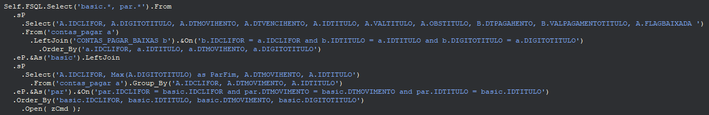

<p align="center">
  
</p>

<h1 align="center">PowerSQLBuilder</h1>

<p align="center">
  <strong>Biblioteca Delphi para construção e execução fluente de comandos SQL</strong>
  <br />
  <em>Delphi library for fluent SQL statement building and execution</em>
</p>

<p align="center">
  
  
  
  
</p>

---

## Sobre / About

**PowerSQLBuilder** é uma biblioteca Delphi (Object Pascal) que fornece uma API fluente (builder pattern) para construção e execução de comandos SQL, eliminando a necessidade de concatenar strings SQL manualmente.

Ela suporta **4 bibliotecas de acesso a dados** simultaneamente:

| Biblioteca | Componentes |
|------------|-------------|
| **ZeosLib** | `TZConnection`, `TZQuery` |
| **FireDAC** | `TFDConnection`, `TFDQuery` |
| **UniDAC** (Devart) | `TUniConnection`, `TUniQuery` |
| **ADO** | `TADOConnection`, `TADOQuery` |

E **8 bancos de dados**, com sintaxe adaptada automaticamente:

- PostgreSQL
- MySQL / MariaDB
- Microsoft SQL Server
- Firebird
- SQLite
- IBM DB2
- MongoDB

---

## Funcionalidades / Features

### Construção de SQL (SQL Building)
- **SELECT** com joins, subqueries, agregações, CTEs (`WITH`)
- **INSERT** com `Field()` encadeado e `Values` / `EndValues`
- **UPDATE** com `UpField()` para campo/valor
- **DELETE** com cláusulas `WHERE`
- **DDL**: `CREATE TABLE`, `ALTER TABLE`, `DROP TABLE`, `CREATE VIEW`, `ALTER VIEW`, `DROP VIEW`, `TRUNCATE TABLE`
- **CASE / WHEN / THEN / ELSE / END**
- **Operadores**: `=`, `>`, `>=`, `<`, `<=`, `<>`, `LIKE`, `BETWEEN`, `IN`, `NOT IN`, `IS NULL`, `IS NOT NULL`
- **Joins**: `LEFT JOIN`, `RIGHT JOIN`, `INNER JOIN`, `FULL JOIN`
- **Parentheses** aninhados com `sP()` / `eP()`
- `ON DUPLICATE KEY UPDATE` (MySQL)
- `RETURNING` (PostgreSQL)
- `OUTPUT` (MSSQL)
- `LIMIT` / `TOP`
- `UNION`
- Funções: `COUNT`, `SUM`, `MAX`, `MIN`, `DISTINCT`, `CAST`

### Execução (Execution)
- `.Execute()` — para comandos **INSERT, UPDATE, DELETE, DDL**
- `.Open()` — para comandos **SELECT**, retorna dados no `TDataSet`
- Suporte a **BLOB** via `.FieldBlob()` e `.UpFieldBlob()`
- **Retry automático**: até 3 tentativas com reconexão automática em erros de servidor

### Formatação automática de tipos
Valores são automaticamente formatados conforme o banco de dados selecionado:

| Tipo Delphi | Formato |
|-------------|---------|
| `String` | `'valor'` (quoted) |
| `Integer` / `Int64` | literal numérico |
| `Double` | separador decimal `.` |
| `Boolean` | `true/false` (Pg, FB, DB2) ou `1/0` (MySQL, MSSQL, SQLite) |
| `TDateTime` / `TDate` / `TTime` | `'yyyy-mm-dd hh:nn:ss'` com tratamento de `null` |
| `TGUID` | `UNHEX('...')` |

### Utilitários
- **SQL Logging**: log de comandos executados em arquivo texto
- **MD5 Hash**: `GetHash()` gera hash MD5 do SQL
- **JSON**: `GetJson()` gera JSON de resultados PostgreSQL via `row_to_json`
- **Ping**: função `Ping()` para verificar disponibilidade de host via ICMP
- **DataSet helpers**: `First()`, `NextRecord()`, `Prior()`, `Last()`, `RecordCount`, `Eof`, `Bof`, `Active`, `Edit`, `Append`, `Post`
- **Field accessors**: `getInteger()`, `getString()`, `getFloat()`, `getBoolean()`, `getDateTime()`, `getBlob()`, etc.

---

## Arquitetura / Architecture

```
TObject
  └── TPowerSQLBuilder      (PowerSqlBuilder.pas)
        └── TSQLQuery       (SQLQuery.pas)
```

- **`TPowerSQLBuilder`** — classe base que constrói o SQL via `TStringBuilder` com method chaining. Declara _callbacks_ abstratos para execução.
- **`TSQLQuery`** — descendente concreto que implementa os callbacks para ZeosLib, FireDAC, UniDAC e ADO. Adiciona navegação de dataset, suporte a BLOB, logging e retry automático.

---

## Instalação / Installation

### Pré-requisitos
- Embarcadero RAD Studio (Delphi) 12 ou compatível
- Componentes de terceiros (conforme uso):
  - [ZeosLib](https://sourceforge.net/projects/zeoslib/)
  - [Devart UniDAC](https://www.devart.com/unidac/) v2.80
  - [Devart DAC](https://www.devart.com/dac/) v2.80
  - Indy (embutido no Delphi)
  - FireDAC (embutido no Delphi)

### Compilação
1. Abra `PowerSQL.dproj` no RAD Studio
2. Compile o pacote runtime (gera `PowerSQL.bpl`)
3. Adicione os paths das units ao seu projeto
4. Adicione `PowerSQL.bpl` aos pacotes runtime do seu projeto
5. Use `uses SQLQuery;` no seu código

---

## Exemplos de Uso / Usage Examples

### SELECT
```pascal
FSQL.Select('nome, limite, ativo')
  .From('clientes')
    .Order_By('id')
      .Open(zCmd);
```

```pascal
FSQL.SelectFrom('clientes')
  .Where('ativo').Equal(model.ativo)
    .And('limite').MajorEqual(model.limite)
      .Order_By('id')
        .Open(zCmd);
```

### INSERT
```pascal
FSQL.Insert('clientes')
  .Fields('nome, limite, ativo, data')
    .Values
      .Field(model.nome).Next
      .Field(model.limite).Next
      .Field(model.ativo).Next
      .Field(model.data).EndValues
        .Execute(zCmd);
```

### UPDATE
```pascal
FSQL.Update('clientes')
  .UpField('limite', model.limite).Next
  .UpField('data', model.data)
    .Where('ativo').Equal(model.ativo)
      .Execute(zCmd);
```

### DELETE
```pascal
FSQL.DeleteFrom('clientes')
  .Where('nome').Like(model.nome)
    .And('ativo').Equal(model.ativo)
      .Execute(zCmd);
```

### Subquery com Joins
```pascal
FSQL
  .sP
    .Select('A.IDCLIFOR, A.DIGITOTITULO, A.DTMOVIHENTO')
    .From('contas_pagar a')
      .LeftJoin('CONTAS_PAGAR_BAIXAS b')
        .On('b.IDCLIFOR = a.IDCLIFOR and b.IDTITULO = a.IDTITULO')
          .Order_By('a.IDCLIFOR, a.IDTITULO')
  .eP.As('basic')
  .LeftJoin
  .sP
    .Select('A.IDCLIFOR, Max(A.DIGITOTITULO) as ParFim')
    .From('contas_pagar a')
      .Group_By('A.IDCLIFOR, A.DTMOVIMENTO, A.IDTITULO')
  .eP.As('par')
    .On('par.IDCLIFOR = basic.IDCLIFOR')
      .Open(zCmd);
```

### CASE Statement
```pascal
FSQL.Select
  .Case('status')
    .When('1').Then('Ativo')
    .When('0').Then('Inativo')
    .Else('Indefinido')
  .End('status_descricao')
  .From('clientes')
    .Open(zCmd);
```

### WITH (CTE)
```pascal
FSQL.With('cte AS (SELECT * FROM clientes WHERE ativo = true)')
  .Select('*')
  .From('cte')
    .Open(zCmd);
```

---

## Configuração de Banco / Database Setup

Antes de executar comandos, selecione o SGDB:

```pascal
FSQL.PostgreSQL;  // ou .MySQL, .MSSQL, .FireBird, .SQLLite, .DB2, .Mongo
```

---

## Logging SQL

Ative o log para depuração:

```pascal
FSQL.LogSQL := True;
FSQL.PathLog := 'C:\Logs\';
```

Os comandos serão registrados em `C:\Logs\LogSQL.txt`.

---

## Licença / License

Este projeto está licenciado sob a **GNU General Public License v3.0**. Veja o arquivo [LICENSE](LICENSE) para mais detalhes.

---

## Autor / Author

**Antonio Julio** — [@juliospd](https://github.com/juliospd)

---

## Repositório / Repository

[https://github.com/juliospd/PowerSQLBuilder](https://github.com/juliospd/PowerSQLBuilder)
